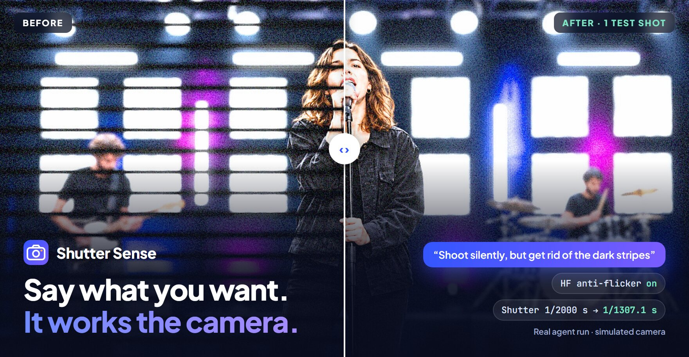
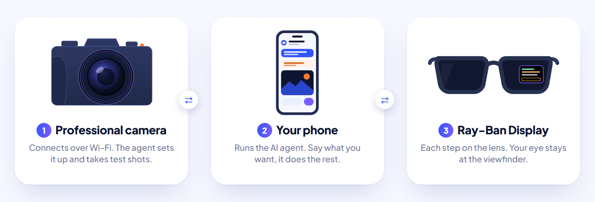
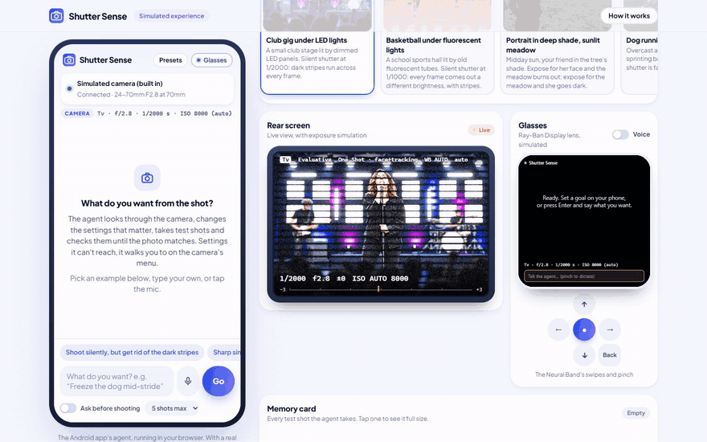
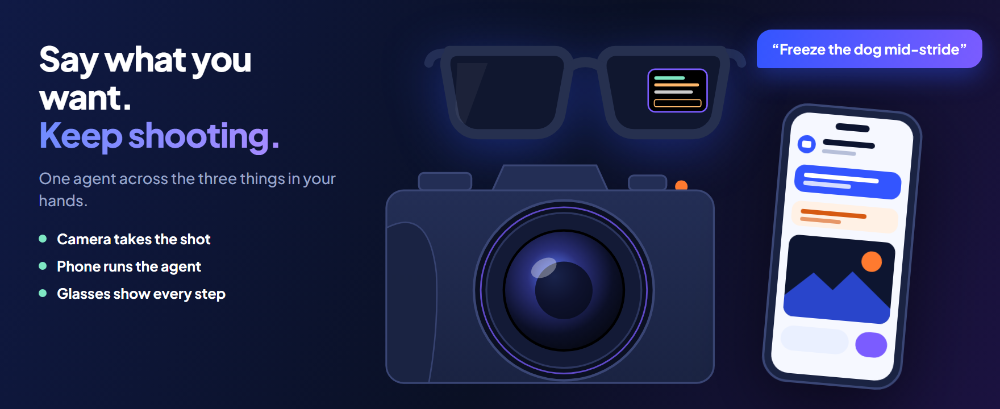
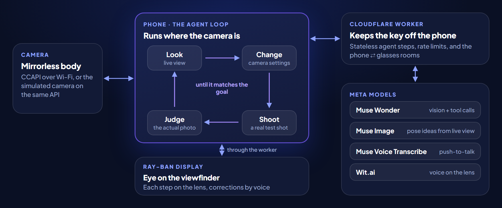

<p align="center">
  <a href="https://shuttersense.pages.dev/try"></a>
</p>

<p align="center">
  <a href="https://shuttersense.pages.dev/try"></a>
  <a href="https://www.youtube.com/watch?v=CIH_PXiTaXg"></a>
</p>
<p align="center">
  
  
  
  
</p>

**Shutter Sense is an AI agent that works your camera for you.**

You say what you want from the shot: *"shoot silently, but get rid of the dark stripes"*, *"freeze the dog mid-stride"*, *"get all three of them sharp"*. The agent looks through the live view, changes the camera's settings, takes a test shot, looks at the photo it got, and tries again until the shot matches. Then it tells you what it changed and why, in photography terms.

This isn't a chatbot that comments on photos. It operates a mirrorless camera over Wi-Fi through Canon's Camera Control API (CCAPI) and checks its own work on the actual photo.

<p align="center">
  
</p>

<p align="center">
  
  <br><sub>The real agent on the simulated camera, sped up 3×: phone app, rear screen and Ray-Ban Display lens.</sub>
</p>

## What it does

<p align="center">
  
</p>

- **It acts, then checks.** The agent changes real settings, shoots, and judges the photo against your goal, within a shot budget you set.
- **It knows the settings most people never find.** High-frequency anti-flicker, servo tracking, the AF point, metering modes, white balance shift, picture style fine-tuning.
- **It walks you through what the API can't reach.** For settings like HDR Mode or high-speed sync, it shows the camera's real menu screens, page by page, and waits until you've set them.
- **Your eye stays at the viewfinder.** On Ray-Ban Display, the lens shows each step and settings change, and you correct it by voice ("a bit warmer").
- **It has ideas and remembers.** Ask for other poses and Muse Image re-imagines the live view with the same people in the same place. Say "save this as club night" to keep a setup as a preset.

## Try it

**https://shuttersense.pages.dev/try** runs in your browser, with no camera, account or install.

1. Pick a scene: a club gig under LED lights, basketball under fluorescent tubes, a portrait in deep shade, a running dog, a group portrait or a birthday dinner.
2. Tap an example goal in the phone, or type your own, and watch each step and settings change.
3. Send a correction, such as *"a bit warmer"*, or ask for *"a few other poses for her"*.
4. **Connect simulated glasses** to see the same run on the 600×600 lens.

### On an Android phone

<a href="https://github.com/krzychuwr1/ShutterSense/releases/latest/download/shutter-sense.apk"></a>

The phone app is the real agent, and **Try the demo** runs a simulated camera on the phone, so you still don't need a Canon body. It needs Android 9 or newer and an internet connection.

1. [Download the APK](https://github.com/krzychuwr1/ShutterSense/releases/latest/download/shutter-sense.apk) on your phone, or scan the code.
2. Open the file and allow installs from your browser if asked. If Play Protect doesn't recognize the developer, tap **More details**, then **Install anyway**.
3. Open Shutter Sense, tap **Skip**, then **Try the demo**, and tap an example goal.

### With the real hardware

The demos above use a simulated camera so that anyone can try the agent. Shutter Sense itself is built for real hardware, and the full setup works: the [trailer](https://www.youtube.com/watch?v=CIH_PXiTaXg) is a real recording of the agent running a real camera. Testing it properly takes all three:

- **An Android phone** with the app above, on the same Wi-Fi as the camera. Tap **Connect my camera** instead of **Try the demo**.
- **A Canon camera with CCAPI**, activated through Canon's developer programme.
- **Meta Ray-Ban Display** with Developer Mode on and https://shuttersense.pages.dev installed as a web app.

See [docs/technical.md](docs/technical.md) for connecting the camera and pairing the glasses.

## How it works

<p align="center">
  
</p>

The agent loop runs on the phone, because the phone is what can reach the camera: a browser can't call the camera's plain HTTP API from an HTTPS page. Each step sends the compact transcript to the worker, which adds the instructions and tools, calls the model and returns the tool calls for the phone to run. Steps are stateless, so nothing expires mid-run. Settings are checked against the camera's own option lists, storage, network and power are off limits, and you can cancel at any time.

| Meta model | What it does here |
| --- | --- |
| **Muse Wonder** | The agent. It sees live view and test photos as tool results, chooses tools and judges its own shots |
| **Muse Image** | Pictures pose ideas: the live-view frame re-imagined, or a picture from a prompt |
| **Muse Voice Transcribe** | Push-to-talk goals and corrections, on the phone and the glasses |
| **Wit.ai** | Reads the agent's notes aloud on the lens |

## Technical decisions

**The glasses app is a web app.** Ray-Ban Display can install a website as an app, so the HUD is plain web code rather than a native build. That made it quick to test: the lens is a 600×600 page, so it runs in any browser with the same code that runs on the glasses, and the simulated lens in the demo is that same app. It also makes it easy to share: anyone with Developer Mode can add the deployed site to their glasses, with no build or store release.

**The simulator exists so judges can test it without a Canon camera.** Using the real thing takes a Canon body with CCAPI activated, which few people have to hand. The simulated camera answers the same API, so the same client, tools and agent loop run against it unchanged, and anyone can try the whole experience from a browser. It renders in physical units (exposure, depth of field, motion blur, noise, per-row flicker), so a wrong setting looks wrong for the same reason it would on a real body.

## Run it yourself

```bash
npm install
```

```bash
echo MUSE_API_KEY=your-key > .dev.vars
```

```bash
npm run dev:worker
```

Then open http://127.0.0.1:8790 and click **Try the simulated experience**. Tests run with `npm test`.

See [docs/technical.md](docs/technical.md) for the full tool list, the CCAPI client, the simulator, deployment, the glasses and connecting a real camera, and [android/README.md](android/README.md) for the phone app.

## Built during the hackathon

Everything in this repository was written during the Meta Global AI Developer Hackathon: the CCAPI clients (TypeScript and Kotlin), the agent loop and tools, the Android app, the simulated camera and its renderer, the web demo, the glasses HUD and the worker.

The simulator's scene photographs are AI-generated, made during the hackathon. No real people are pictured.

Works with Canon cameras via CCAPI. Not affiliated with or endorsed by Canon.

[MIT License](LICENSE)
